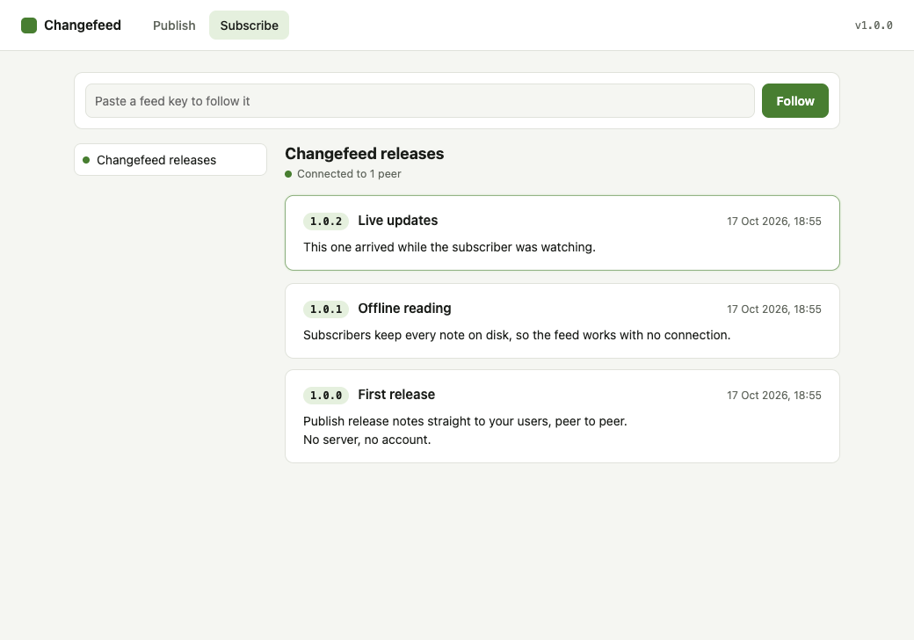
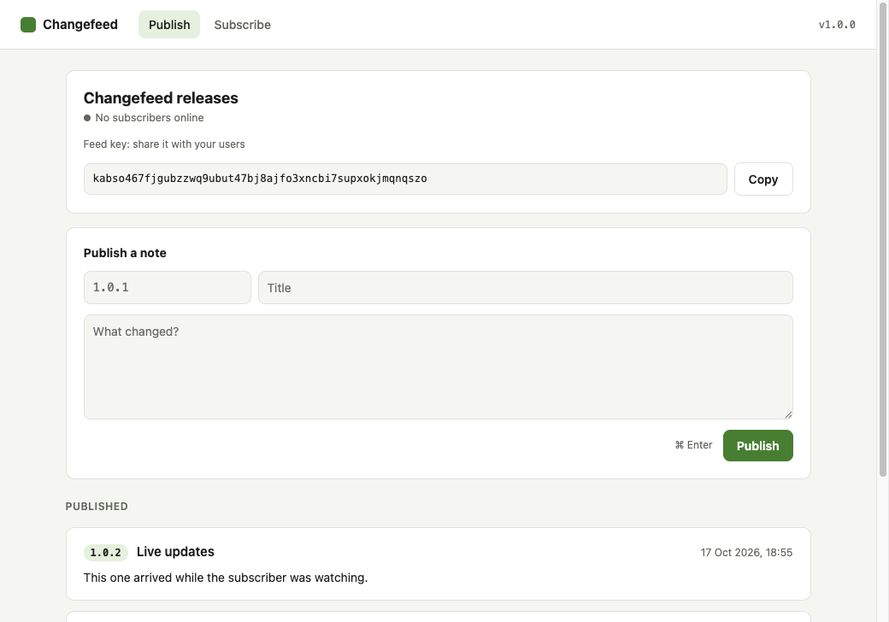

# Changefeed

Peer-to-peer release notes. A maintainer publishes notes from their own
machine. Subscribers follow the feed with a key, get new notes live, and keep
every note on disk, so it works offline. No server, no account.



## Install

macOS on Apple silicon:

```sh
# 1. Install the Pear CLI, then open a new terminal
curl https://install.pears.com/pear.sh | sh

# 2. Install Changefeed
pear install pear://7ffucmhbpa7z5hcao4t6435c6ndqryn38iu6nfzqwubqykap15yy
```

3. Open **Changefeed** from `~/Applications`.

If the install stays on "looking for peers", no peer that has the app is
online. Try again later.

## Use it

**Follow a feed:** open **Subscribe** and paste a feed key. Try the demo feed:

```
truftdtxp1mbq7mpkgrsputayfhsytsfjacsmuknpyozasug7pzo
```

**Publish your own:** open **Publish**, name your feed, copy the feed key and
share it. Then write a note (version, title, body) and press **Publish**
(⌘ Enter).



Each device has one feed, and only that device can publish to it.

## Follow a feed from the terminal

macOS or Linux, with Node:

```sh
git clone https://github.com/iamfortune/changefeed && cd changefeed
npm install
npm run cli -- subscribe <feed-key>
```

It prints saved notes, then new ones as they arrive (marked `● new`). Use
`--storage <dir>` to choose where notes are saved.

## Develop

```sh
npm install
npm start                                  # first window
npm start -- --storage /tmp/changefeed-b   # second window, separate storage
npm test
npm run lint
```

Create a feed in one window and subscribe from the other.

| Folder      | What it does                                       |
| ----------- | -------------------------------------------------- |
| `backend/`  | Feeds, notes and syncing. Shared by app and CLI.   |
| `workers/`  | Runs `backend/` and app updates for the desktop.   |
| `electron/` | Opens the window and passes messages to the worker |
| `renderer/` | The UI (plain HTML, CSS and JS)                    |
| `cli/`      | The terminal app                                   |
| `test/`     | Backend, worker and CLI tests                      |

## More

- [How it works](docs/how-it-works.md): architecture, data format, updates,
  releasing, limitations.
- [AGENTS.md](AGENTS.md): notes for coding agents working on this repo.
